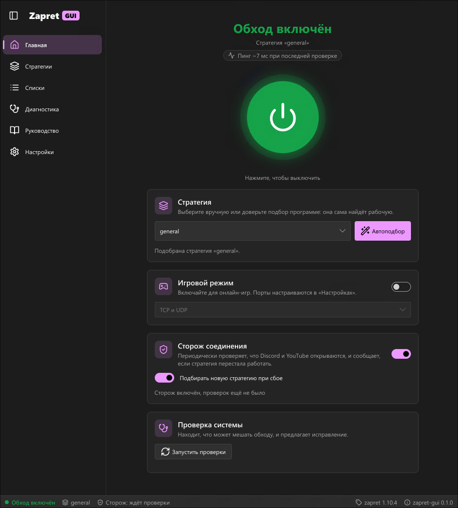

<div align="center">
  
</div>

---

<div align="center">

**Простая программа для Windows, которая возвращает Discord и YouTube одной кнопкой.**

[](https://github.com/duckysmacky/zapret-gui/releases)
[](https://github.com/duckysmacky/zapret-gui/releases)
[](https://github.com/duckysmacky/zapret-gui/releases)
[](https://github.com/duckysmacky/zapret-gui/actions/workflows/test.yml)
[](LICENSE)
[](https://www.rust-lang.org)

</div>

> **zapret-gui - неофициальная программа.** Это не проект zapret и не проект Flowseal. Об ошибках программы
> сообщайте в этот репозиторий, а не авторам zapret.

## Что это и зачем

Во многих сетях Discord и YouTube открываются плохо или не открываются совсем. Для этого есть бесплатный проект
[zapret-discord-youtube](https://github.com/Flowseal/zapret-discord-youtube) (автор Flowseal), но он рассчитан на
тех, кто готов разбираться: нужно скачать архив, найти подходящий `.bat`-файл, запустить его от имени
администратора и пробовать разные варианты, пока что-то не заработает.

**zapret-gui делает всё это за вас.** Вы нажимаете одну большую кнопку, а программа сама скачивает zapret,
подбирает рабочий способ обхода и следит, чтобы он не перестал работать. Командная строка и `.bat`-файлы не нужны, а вместо их удобный интерфейс.


<div align="center">
  
</div>

## Возможности

Приложение полностью повторяет фукнционал оригинального [zapret-discord-youtube](https://github.com/Flowseal/zapret-discord-youtube), но также добавляет кучу совбственных функций, которые намного облегчают обход блокировок.

### Новые эксклюзивные функции

- **Включение одной кнопкой:** Большая круглая кнопка на главном экране: серая - выключено, зелёная - работает.
- **Автоподбор стратегий:** Если что-то не открывается, программа сама перебирает способы обхода (они называются
  "стратегии") и оставляет тот, который работает. Есть быстрый подбор (до первого рабочего) и полный (с рейтингом).
- **Автоматические обновления zapret:** Программа сама скачивает свежие версии. При желании можно вернуться
  к старой версии.
- **Сторож соединения:** Периодически проверяет, открываются ли Discord и YouTube, и сообщает, если перестали.
- **Понятный интерфейс на русском языке:** Светлая и тёмная темы. Внутри программы есть страница "Руководство" с подробным описанием каждого раздела.
  Может сам подобрать новый способ.
- **Работа в фоне:** Закрытие окна прячет программу в трей (значок у часов). Можно запускать вместе с Windows и включать обход сразу при старте.
- **Автозапуск вместо службы:** Оригинальный zapret как службу Windows. Здесь вместо этого есть
автозапуск вместе с Windows и включение обхода при старте программы.
- **Удаление старых служб:** Останавливает и удаляет службы zapret и WinDivert, оставшиеся от прошлых установок, и завершает `winws.exe`.

### Оригинальные функции zapret

Всё, что умеет меню `service.bat` из zapret-discord-youtube, доступно в программе кнопками и переключателями:

- **Готовые стратегии:** Все варианты обхода из zapret (`general`, `general (ALT)` и другие) собраны в одном списке. Любую можно включить вручную или проверить по отдельности.
- **Игровой режим:** Помогает, если не подключается онлайн-игра. Есть режимы "TCP и UDP", "Только TCP" и "Только UDP", а диапазоны портов можно изменить в настройках.
- **Режим IPSet:** Три режима: выключен, по списку (по умолчанию) и для всех IP-адресов. Список IPSet можно обновить одной кнопкой.
- **Свои списки сайтов:** Добавляйте свои домены для обхода, исключайте сайты и IP-адреса, которым обход мешает. Записи проверяются, а после сохранения обход сам перезапускается.
- **Просмотр списков zapret:** Можно посмотреть и найти сайт в списках, которые идут вместе с zapret.
- **Фейковые пакеты:** Выбор файла-приманки отдельно для Discord и для игр (UDP). Нужно только опытным пользователям, по умолчанию всё настроено.
- **Диагностика компьютера:** Те же проверки, что в оригинальном zapret, но с понятными подсказками и кнопками исправления: нужные службы Windows, системный прокси, TCP timestamps, AdGuard, VPN, защищённый DNS, путь установки (кириллица, OneDrive), наличие драйвера WinDivert, записи в hosts и другие. Мешающие программы выделяются сразу.
- **Тесты стратегий:** Стандартный тест (открываются ли Discord, YouTube и другие сайты, какой пинг) и DPI-тест (ищет "заморозку" соединения). Можно проверить одну стратегию или все сразу.
- **Обновление файла hosts:** Показывает, чего не хватает, и вносит изменения только после вашего подтверждения. Перед этим всегда делается резервная копия, из которой файл можно вернуть.
- **Очистка кэша Discord:** Закрывает Discord и удаляет его кэш. Помогает, когда после включения обхода он всё равно не подключается.

## Установка

Приложение можно скачать со страницы [Releases](https://github.com/duckysmacky/zapret-gui/releases).

1. **Удалите старые установки zapret** и других обходов (GoodbyeDPI и т.п.), особенно если ставили их как службу (`service.bat`, пункт "Remove Services"). Иначе обход не запустится.
2. Скачайте `zapret-gui-setup-<версия>.exe` со страницы [Releases](https://github.com/duckysmacky/zapret-gui/releases) и запустите.
3. При первом запуске программа сама скачает zapret, подберёт рабочую стратегию и предложит автозапуск.

### Предупреждения Windows

- **SmartScreen** ("Система Windows защитила ваш компьютер"): установщик пока не подписан, поэтому винда будет ругаться. Нажмите "Подробнее" -> "Выполнить в любом случае".
- **Антивирус или Defender** может ругаться на `winws.exe` или драйвер WinDivert из zapret: это инструменты, перехватывающие сетевой трафик, поэтому антивирусы часто считают их подозрительными. Если файл удалён, раздел "Диагностика" покажет проблему с `WinDivert64.sys` и предложит скачать версию заново.
- Программе нужны **права администратора** (драйвер WinDivert работает только так). При ручном запуске
  Windows спросит разрешение, при автозапуске - нет.

## Обновление

Просто скачайте новый новый установщик и запустите его - старая версия будет автоматически заменена. Если zapret-gui сейчас запущен, установщик попросит закрыть его.

### Удаление

"Параметры Windows" -> "Приложения" -> zapret-gui -> "Удалить". Удаляются программа, скачанные версии zapret,
задача автозапуска и служба WinDivert. Настройки удаляются по желанию.

## Быстрый старт

1. Запустите zapret-gui. Если появилась жёлтая полоса "запущена без прав администратора", нажмите "Перезапустить от имени администратора".
2. Дождитесь, пока мастер первого запуска скачает zapret и подберёт способ обхода.
3. На главном экране нажмите большую круглую кнопку. Когда она станет зелёной, можно открывать Discord и YouTube.
4. Что-то не открывается? Нажмите "Автоподбор" и подождите. Во время подбора интернет несколько раз ненадолго пропадает, это нормально.
5. Не подключается онлайн-игра? Включите переключатель "Игровой режим".
6. Всё равно не работает? Откройте "Диагностика" и нажмите "Запустить проверки". Программа покажет, что мешает, и предложит исправление.

Чтобы выключить обход, нажмите на кнопку ещё раз. Крестик в углу окна программу **не выключает**: она прячется
в трей и продолжает работать. Чтобы закрыть её полностью, нажмите правой кнопкой на значок в трее и выберите
"Выход" (или кнопку "Выйти из программы" в "Настройках"). При выходе обход останавливается.

## Благодарности

- [Flowseal/zapret-discord-youtube](https://github.com/Flowseal/zapret-discord-youtube) - стратегии и списки (MIT)
- [bol-van/zapret](https://github.com/bol-van/zapret) - движок winws (MIT)
- [WinDivert](https://github.com/basil00/WinDivert) - драйвер перехвата пакетов (LGPL-3.0)
- [hyperion-cs/dpi-checkers](https://github.com/hyperion-cs/dpi-checkers) - набор DPI-проверок (Apache-2.0)
- [Slint](https://slint.dev) - интерфейс
- [Lucide](https://lucide.dev) - иконки (ISC)

Лицензия [MIT](LICENSE).

## Для разработчиков

zapret-gui - это Rust workspace из двух крейтов:

| Крейт | Что внутри |
|---|---|
| `core` | Вся логика: синхронизация с upstream, разбор стратегий, запуск winws, проверка сайтов, подбор, сторож, диагностика, конфиг. Код только для Windows спрятан за платформенными швами (platform seams): есть настоящая реализация (Windows) и mock (Linux) |
| `ui` | Приложение на Slint (`zapret-ui`): `.slint`-файлы, связка состояния `core` со Slint, трей, жизненный цикл окна |

На Linux приложение собирается и запускается с mock-платформой (имитация winws, проверок сайтов и служб), поэтому для большей части работы Windows не нужна. Я сам писал приложение полностью на Linux, а тестировал через виртуалку.

### Требования

- Rust (stable, edition 2024) и `cargo`
- По желанию: [`just`](https://github.com/casey/just) для команд-сокращений ниже
- Для сборки под Windows с Linux: [`cargo-xwin`](https://github.com/rust-cross/cargo-xwin). Для установщика: Inno Setup (на Linux запускается через Wine)

### Команды

```sh
cargo run -p zapret-ui                  # Linux: mock-платформа
cargo fmt --all
cargo clippy --workspace --all-targets -- -D warnings
cargo test --workspace
```

То же через `just`:

```sh
just run          # запустить приложение
just check        # fmt + clippy + тесты
just check-win    # проверить, что собирается под Windows
just build-win    # релизный exe для Windows
just installer    # exe + установщик Inno Setup
```

Сценарии mock-режима для проверки ошибок:

```sh
ZAPRET_GUI_MOCK_SCENARIO=winws_exits cargo run -p zapret-ui
# также: nothing_works, download_fails, not_elevated
```

### Что нужно знать перед pull request

- `.bat`-файлы upstream разбираются как текст и никогда не запускаются.
- Распаковка архивов должна отклонять path traversal и идти только в новую временную папку.
- Файлы, которые запускаются с правами администратора, лежат в папке, доступной для записи только администратору.
- Записи пользовательских списков - это данные: их нужно проверять и записывать только в файлы списков.
- Все вызовы, специфичные для Windows, идут через платформенные швы в `core`.
- В `.slint`-файлах и в связке с UI нет бизнес-логики.
- Интерфейс только на русском: обычные строковые литералы, без слоя i18n.
- Перед отправкой изменений: `cargo fmt`, `clippy` без предупреждений и все тесты проходят.
